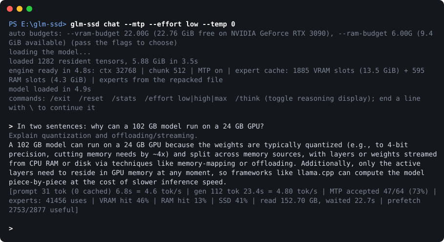

# GLM-SSD

Run **GLM-5.3-Flash**, a 102 GB mixture-of-experts model, on a single consumer GPU.

glm-ssd is an inference engine for GLM-5.3-Flash written from scratch in Rust and CUDA. Most of
the model is its routed experts: 42 layers × 288 experts, of which each token uses only 8 per
layer. glm-ssd keeps everything else resident on the GPU (~6 GB). It streams the experts from an
NVMe SSD on demand and caches the hot ones in VRAM and pinned RAM. On an RTX 3090 with a Samsung
990 PRO it decodes at **6-12 tokens/s**, and it serves an **OpenAI-compatible API** that chat
apps and coding agents can talk to.

- One executable, no Python: download, chat, serve.
- An OpenAI-compatible server with streaming, tool calls and reasoning effort. It keeps a
  prompt cache across turns, so a multi-turn chat or agent loop only processes new tokens.
- Speculative decoding with the model's own MTP layer (`--mtp`): ~85% of drafts are accepted.
- An SSD-friendly repacked expert file (`glm-ssd repack`), learned hot-expert profiles,
  prefetching of the next layer's experts, and optional cache-aware routing for more speed.
- Context up to 128K tokens on a 24 GB GPU.



> **Status:** an early release (v0.1). It runs on Windows only, with one NVIDIA GPU, and supports
> only the GLM-5.3-Flash architecture. See [Limitations](#limitations).

## Contents

- [Requirements](#requirements)
- [Quick start](#quick-start)
- [Chat](#chat)
- [OpenAI-compatible server](#openai-compatible-server)
- [Memory budgets](#memory-budgets)
- [Making it faster](#making-it-faster)
- [All options](#all-options)
- [Other GLM-5.3-Flash models](#other-glm-53-flash-models)
- [Performance](#performance)
- [How it works](#how-it-works)
- [Troubleshooting](#troubleshooting)
- [Building from source](#building-from-source)
- [Limitations](#limitations)
- [License and credits](#license-and-credits)

## Requirements

| | Minimum | Reference machine |
|---|---|---|
| OS | Windows 10/11, x64 | Windows 11 |
| GPU | NVIDIA, Ampere or newer (RTX 30xx / 40xx / 50xx, A-series), 12 GB VRAM | RTX 3090, 24 GB |
| SSD | NVMe; 102 GB free for the model, plus 95 GB for the optional repacked file | Samsung 990 PRO (PCIe 4.0) |
| RAM | 16 GB | 32 GB |
| Driver | a current NVIDIA driver (the binary uses CUDA 12.9) | |

Speed depends on how much of the model fits in your caches and on the SSD's random-read speed.
More VRAM and RAM mean fewer SSD reads per token. A 12 GB budget works but is slow (~3.7 tok/s
on the reference machine, against ~6 with 22 GB). A SATA SSD or a hard drive is much slower.

## Quick start

1. **Get glm-ssd.** Download `glm-ssd-v0.1.0-windows-x64.zip` from the
   [latest release](https://github.com/ManyGlue0/GLM-SSD/releases/latest) and unzip it into a
   folder on a drive with ~200 GB free, e.g. `D:\glm-ssd`. Models are stored in a `models`
   folder next to the exe. To build it yourself instead, see
   [Building from source](#building-from-source).

   **Add it to PATH** so that `glm-ssd` works from any folder. Open PowerShell in the folder
   (in Explorer: right-click inside it → *Open in Terminal*) and run:

   ```
   [Environment]::SetEnvironmentVariable("Path", [Environment]::GetEnvironmentVariable("Path", "User") + ";$PWD", "User")
   ```

   Then open a new terminal. The models stay next to the exe whichever folder you run it from.
   If you skip this step, run it from its own folder as `.\glm-ssd` (PowerShell doesn't run
   programs from the current folder without the `.\`).

2. **Download the model** (~102 GB, unsloth's `UD-IQ2_XXS` GGUF). The download is resumable and
   SHA-256 verified; if it's interrupted, run the same command again:

   ```
   glm-ssd download
   ```

3. **Repack the experts** (optional, recommended). This writes the experts into one more file of
   ~95 GB, laid out so that each expert is a single SSD read instead of three. It takes about a
   minute on a fast NVMe drive and makes decoding ~10% faster:

   ```
   glm-ssd repack
   ```

4. **Chat:**

   ```
   glm-ssd chat --mtp
   ```

   The first start takes a few seconds. The first answer is slower than the following ones,
   because the expert caches start empty (see [Performance](#performance)).

Check your GPU at any time with `glm-ssd gpu`.

## Chat

```
glm-ssd chat --mtp
```

GLM-5.3-Flash always reasons before it answers. The reasoning is shown dimmed; `/think` hides
or shows it.

| Command | |
|---|---|
| `/effort low\|high\|max` | reasoning effort (default `max`). `low` answers much sooner |
| `/think` | show or hide the reasoning |
| `/reset` | start a new conversation |
| `/stats` | cache and speed statistics |
| `/exit` | quit |

End a line with `\` to continue typing on the next one. `--system "..."` sets a system prompt,
`--effort low` the starting effort, and `--temp`, `--top-p`, `--top-k`, `--min-p` and `--seed`
control sampling.

## OpenAI-compatible server

```
glm-ssd serve --mtp --ctx 65536
```

This listens on `http://127.0.0.1:8080` (`--addr` to change it). Point any OpenAI-compatible
client at `http://127.0.0.1:8080/v1` with any API key and the model name `glm-5.3-flash`
(`--name` to change it).

```
curl http://127.0.0.1:8080/v1/chat/completions -H "Content-Type: application/json" -d "{\"model\": \"glm-5.3-flash\", \"messages\": [{\"role\": \"user\", \"content\": \"Hello!\"}], \"stream\": true}"
```

Supported:

- `POST /v1/chat/completions` and `POST /v1/completions`, streaming or not. Streams carry both
  `reasoning_content` and `content` deltas; `stream_options.include_usage` adds usage.
- Tool calling (OpenAI `tools` format, mapped to GLM's native tool-call format), `stop`,
  `max_tokens` / `max_completion_tokens`, `temperature`, `top_p`, `top_k`, `min_p` and `seed`.
- `reasoning_effort` (or `reasoning.effort`): `low`, `high` or `max`. OpenAI-style values are
  mapped: `none`/`minimal` → `low`, `medium` → `high`, `xhigh` → `max`. There is no "off": the
  model always reasons.
- `GET /v1/models`, `GET /health` and llama.cpp-style `GET /props`. These report the context
  window (`context_length`, `max_model_len`, `n_ctx`). A prompt that doesn't fit gets HTTP 400
  `context_length_exceeded`.

Requests are served one at a time. Consecutive requests that share a prefix (multi-turn chats,
agent loops) reuse it: only the new tokens are processed
(`usage.prompt_tokens_details.cached_tokens`). This only works if the client resends earlier
messages unchanged. Anything that changes near the start of the conversation forces a full
re-read, for example the current time in the system prompt or a different `reasoning_effort`.
The server logs where a request stops matching (`prompt cache: request differs ... at token
N`). Put per-turn information such as the time in the newest message instead.

Most clients drop the `reasoning_content` of earlier answers when they send the history back.
The server puts the reasoning back so the conversation still matches its cache.
`--no-reasoning-replay` turns this off and renders the history exactly as sent; earlier answers
are then re-read, which is slower.

After 120 idle seconds (`--idle-unload`, 0 = never) the server frees all VRAM and RAM. The next
request reloads the model in ~5 s, and the conversation's cache is kept in a temp file, so it
continues without being re-read.

**Time to first token.** Each token routes to 8 of the 288 experts in every layer, so even a
short new message reads a few GB from the SSD: ~2 s for a 10-token follow-up. A fresh prompt
longer than ~100 tokens reads nearly every expert that isn't cached, once (~10-15 s), plus the
compute for its length. If your client hides `reasoning_content`, the wait also includes the
reasoning; use `reasoning_effort` `low` or `high` for quicker replies.

## Memory budgets

By default glm-ssd uses the free VRAM minus 0.75 GiB, and 2/3 of the RAM that is available when
it starts. The start-up line shows what it picked:

```
auto budgets: --vram-budget 22.00G (22.76 GiB free on NVIDIA GeForce RTX 3090), --ram-budget 12.00G (18.1 GiB available)
```

To choose them yourself:

- `--vram-budget` is the engine's total VRAM: resident weights (~5.9 GiB), context cache,
  workspace, and the expert cache, which gets whatever is left. Leave room for anything else that
  uses the GPU, such as games, other models or your desktop.
- `--ram-budget` covers the pinned-RAM expert cache and prompt-cache snapshots. Pinned memory
  can't be swapped out, so leave enough for the rest of your system.

`glm-ssd inspect --vram-budget 22G --ram-budget 12G` prints the memory plan without loading the
model.

## Making it faster

Decoding is limited by the SSD reads of experts that aren't cached (~0.4 GB per token on the
reference machine). In order of impact:

1. **`--mtp`**: speculative decoding with the model's MTP layer, which drafts one token and
   verifies it in the same pass. Same output quality.
2. **`glm-ssd repack`**: one read per expert instead of three, ~10% faster.
3. **Bigger budgets**: every GB of cache is fewer SSD reads. Close other GPU apps and give more
   RAM if you have it.
4. **`--cache-aware 0.1`**: when an expert of routing rank 3-8 isn't cached and a cached expert
   scored almost as high (within 0.1), use the cached one. On our tests this gave +65% decode
   speed with no measurable perplexity change. `0.2` gives +95% at about +1.3% perplexity.
   Outputs then depend on what is cached, so they are not exactly reproducible.
5. **`--kv-cache q8`**: a context cache 47% smaller, with no measurable quality change. It
   leaves more VRAM for experts at long contexts.

The engine learns which experts are hot and saves a profile (`hot-experts.txt` next to the
model) on exit. `--preload` fills the caches from it at start-up, so the first answer is faster.

## All options

`glm-ssd <command> --help` lists everything. The engine options shared by `chat`, `serve`,
`bench`, `run` and `ppl`:

| Option | Meaning |
|---|---|
| `-m PATH` | the model: a folder (searched with its subfolders; a folder name inside the models folder is enough) or any `.gguf` shard. Default: the official UD-IQ2_XXS. Also `GLMSSD_MODEL` |
| `--vram-budget SIZE` / `--ram-budget SIZE` | memory budgets, e.g. `22G` (G = GiB). Default: automatic, see [Memory budgets](#memory-budgets) |
| `--ctx N` | max context in tokens (default 32768; up to 131072 fits on 24 GB, more with `--kv-cache q8`) |
| `--mtp` | MTP speculative decoding |
| `--cache-aware M` | cache-aware routing margin (default 0 = exact routing) |
| `--kv-cache f16\|q8` | context cache format |
| `--chunk N` | prefill tokens per batched step (default 512; 1024 is a bit faster and uses more VRAM) |
| `--prefill-batch N` | prefill tokens per pass over the model (default 8192, ~0.8 GB VRAM; 0 = off). Each layer runs over all of them before the next, so uncached experts are read once per pass instead of once per chunk |
| `--prefetch K` | prefetch K predicted experts of the next layer while decoding (default 2) |
| `--preload` | fill the expert caches from the hot-expert profile at start-up |
| `--profile FILE` / `--no-profile` | where usage statistics are kept |
| `--gguf-experts` | read experts from the GGUF even if a repacked file exists |
| `--buffered-io` | read through the OS file cache instead of direct I/O |
| `--io-threads N` | SSD reader threads (default 8) |
| `--snapshots N` | prompt-cache snapshots kept in RAM (~150 MB each, default 6) |
| `--idle-unload SECS` | chat/serve: free VRAM and RAM after this many idle seconds (default 120, 0 = never) |
| `--max-output N` | chat/serve: max tokens per answer, reasoning included (default 0 = until the model stops). In serve, a request's `max_tokens` takes precedence |
| `--temp --top-p --top-k --min-p --seed` | sampling (defaults 0.7 / 0.95 / 40 / 0 / random) |

Environment variables: `GLMSSD_MODELS` (the models folder), `GLMSSD_MODEL` (default `-m`) and
`HF_TOKEN` (for gated or private Hugging Face repos).

## Other GLM-5.3-Flash models

Fine-tunes and re-quantizations with the same architecture work too. `glm-ssd download` takes
any Hugging Face repo, by URL or id:

```
glm-ssd download --url https://huggingface.co/owner/name                        # picks the GGUF model
glm-ssd download --url https://huggingface.co/owner/name/tree/main/UD-IQ2_XXS   # a folder
glm-ssd download --repo owner/name --include "*IQ2_XXS*"                        # by glob
```

If the repo holds a single GGUF model (or a single IQ2_XXS among several), it is picked
automatically; otherwise the choices are listed with their sizes. Files go to
`models\<owner>--<name>\`, so they never overwrite the official model. Use them with
`-m <owner>--<name>`, for example `glm-ssd repack -m owner--name` and
`glm-ssd chat -m owner--name`. Each model keeps its own hot-expert profile.

Supported tensor types: F32, F16, BF16, Q8_0, Q2_K-Q6_K, IQ2_XXS, IQ2_S, IQ3_XXS and IQ4_XS.
Larger quantizations work but read more from the SSD per token, so they decode more slowly.

## Performance

RTX 3090 (24 GB) + Samsung 990 PRO, budgets 22G VRAM / 12G RAM, repacked experts,
`--chunk 1024 --kv-cache q8 --ctx 65536`, cold caches, 300 generated tokens:

| | |
|---|---|
| decode, `--mtp` (exact routing) | ~6.1 tok/s |
| decode, `--mtp --cache-aware 0.1` | ~10 tok/s (no measurable perplexity change) |
| decode, `--mtp --cache-aware 0.2` | ~12 tok/s (~+2% perplexity) |
| decode, `--mtp`, 12G VRAM budget | ~3.7 tok/s |
| prefill, fresh 2.1K-token prompt | 18.6 s (~113 tok/s) |

While decoding, the SSD runs at its random-read maximum (~5.7 GB/s) for most of each token.
`glm-ssd bench` measures decode speed on your machine. `glm-ssd run --prompt "..." -n 200`
prints a per-token breakdown (router sync, SSD wait, kernel launches) and SSD utilization.
`glm-ssd ppl --file text.txt` measures perplexity and speed, to compare options.

## How it works

| Part | Size | Where |
|---|---|---|
| Routed experts (42 layers × 288, plus MTP) | ~95 GB | streamed: SSD → pinned-RAM cache → VRAM cache |
| Attention, routers, shared experts, dense layers, output head | ~5.9 GB | resident in VRAM |
| Token embedding | 0.36 GB | RAM (row lookup on the CPU) |

For each MoE layer, the router runs on the GPU and the CPU picks the 8 experts. Experts already
in VRAM are used directly. Experts in the RAM cache are uploaded on a separate copy stream.
Missing experts are read from the SSD with unbuffered overlapped reads into pinned RAM, by
several reader threads. While layer *L* computes, layer *L+1*'s router runs on *L*'s input to
predict and prefetch its likely experts. Fused kernels compute up to 16 experts at once straight
from the quantized weights, without dequantizing them first. Caches evict by decayed usage
frequency, and the learned profile carries that over between runs.

Prefill runs layer by layer over up to 8192 tokens at a time, so each uncached expert is read
once per pass. Attention is GLM's MLA (with a compressed latent context cache) and KDA linear
attention, written as custom CUDA kernels. Quantized GEMV and GEMM kernels cover every
supported type.

The engine was validated against llama.cpp: `glm-ssd run --trace` prints per-layer tensor
statistics comparable with `llama-eval-callback`, `ref-l0` is an f64 CPU reference of layer 0,
and `qtest` checks every CUDA quant kernel against the CPU reference.

## Troubleshooting

**`... not found. Download the model first`**: run `glm-ssd download`, or pass
`-m <folder or .gguf>`. Models are looked up in the `models` folder next to the exe; set
`GLMSSD_MODELS` to keep them elsewhere, e.g. on another drive.

**`VRAM budget ... is too small`**: close other GPU apps or lower `--ctx` (the context cache
grows with it). 12 GB is the practical minimum.

**`no usable CUDA GPU` / CUDA errors at start**: update the NVIDIA driver and check that
`glm-ssd gpu` passes. GPUs older than Ampere (RTX 20xx and earlier) are not supported.

**Slow first answer**: the caches start empty, so the first prompt reads most experts from the
SSD. Later turns reuse the caches and the prompt cache. `--preload` warms the caches at start.

**The system becomes sluggish**: the RAM budget is pinned memory. Pass a smaller
`--ram-budget`.

**The repacked file is ignored** (the start-up line says `experts from the GGUF`): it no longer
matches the model, for example after a re-download. Run `glm-ssd repack` again (`--force`
rebuilds an up-to-date one). Deleting the `.glm-ssd-experts` file is always safe.

## Building from source

Requirements: Windows x64, Rust (stable), the CUDA Toolkit 12.x (with `CUDA_PATH` set, as the
installer does), and Visual Studio 2022 or its Build Tools with the C++ workload (found
automatically).

```
git clone https://github.com/ManyGlue0/GLM-SSD
cd GLM-SSD
cargo install --path crates/engine --locked
```

This installs `glm-ssd` into `~/.cargo/bin`. A build from source keeps models in the
repository's `models` folder, so the command works from any directory. Kernels are compiled for
the GPU in your machine; set `GLMSSD_CUDA_ARCH` (e.g. `sm_89`, or a list like `80,86,89,120`)
to target others. `tools/release.ps1` builds the release zip.

Developer commands: `qtest`, `qbench`, `iobench`, `tokenize`, `template`, `run --trace` and
`ref-l0`.

## Limitations

- Windows only. The I/O layer uses Windows unbuffered overlapped reads; a Linux port is
  possible but not done.
- One NVIDIA GPU, Ampere or newer.
- GLM-5.3-Flash architecture only (`glm5-next` in the GGUF).
- The server handles one request at a time (requests queue).
- Text only.

## License and credits

glm-ssd is released under the [MIT License](LICENSE).

- The IQ quantization tables and block layouts come from [ggml](https://github.com/ggml-org/ggml)
  (MIT). See [THIRD-PARTY-NOTICES.md](THIRD-PARTY-NOTICES.md).
- [llama.cpp](https://github.com/ggml-org/llama.cpp) served as the reference implementation for
  validating outputs.
- The default model is [unsloth/GLM-5.3-Flash-GGUF](https://huggingface.co/unsloth/GLM-5.3-Flash-GGUF),
  a quantization of GLM-5.3-Flash by Z.ai. Model weights are not part of this project and are
  covered by their own licenses.
